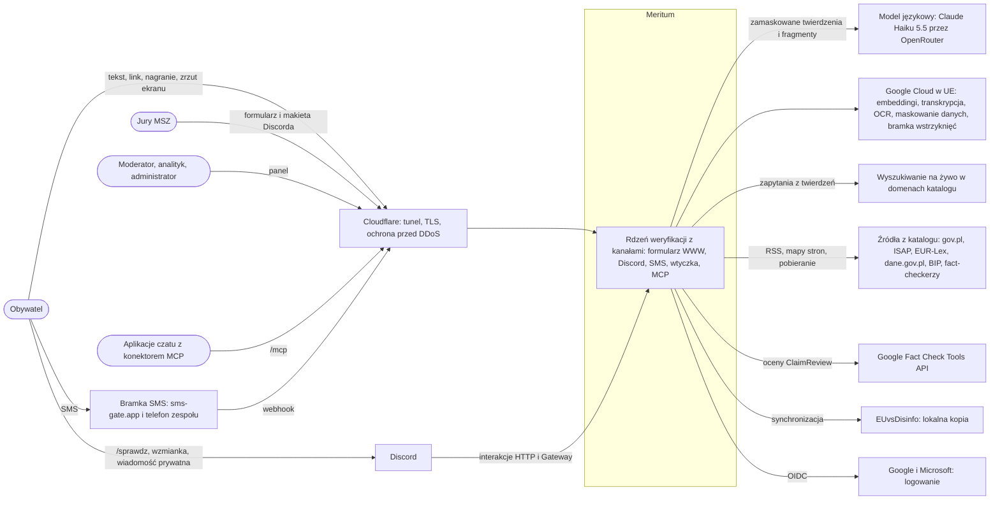
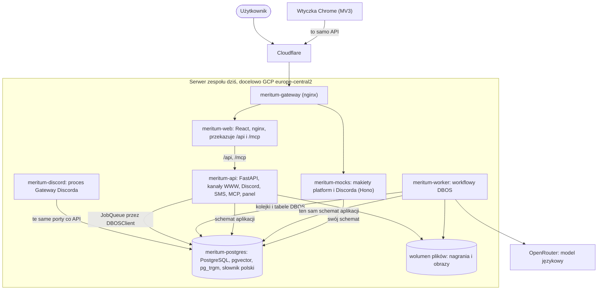

# Kontekst i kontenery

Diagramy C4 pokazują otoczenie systemu i jego kontenery. Opisują stan na gałęzi `develop`; środowisko prd dostaje je po promocji do `main`. Przepływ danych krok po kroku jest na stronie [Przepływ danych](przeplyw-danych.md), kod każdego kontenera w [Komponenty](komponenty.md), a kontrakty i porty w [Porty i adaptery](porty-i-adaptery.md).

## Kontekst systemu

Kto przetwarza jakie dane i gdzie, opisuje strona [Prywatność](../prywatnosc.md).

## Kontenery

| Kontener | Repozytorium | Co robi |
|---|---|---|
| `meritum-web-<env>` | meritum-frontend | statyczny build aplikacji w nginx; `/api` i `/mcp` idą do API tego samego środowiska |
| `meritum-api-<env>` | meritum-backend | FastAPI: sprawdzenia, strumień postępu, nagrania i obrazy, kanały Discord, SMS i MCP, logowanie, panel personelu, powiadomienia, eksport, API ewaluacji, dokumentacja OpenAPI |
| `meritum-discord-<env>` | meritum-backend | proces Gateway Discorda (wzmianki i wiadomości prywatne); startuje tylko, gdy środowisko ma token bota |
| `meritum-worker-<env>` | meritum-worker | trwałe workflowy DBOS: sprawdzenie, sprawy moderatora, usuwanie danych, retencja, wczytywanie korpusu, ewaluacja, archiwizacja stron |
| `meritum-mocks-prd` | meritum-mocks | makiety X, Facebooka, Instagrama, Reddita i TikToka oraz makieta Discorda dla jury, wybierane według nagłówka `Host` |
| `meritum-postgres` | meritum-infra | jedna instancja PostgreSQL z bazą aplikacji `meritum` i osobną bazą DBOS dla każdego środowiska |
| `meritum-gateway` | meritum-infra | nginx platformy, który kieruje adresy `meritum(-*).gburek.app` do kontenerów |

API nie wywołuje workera bezpośrednio. Zleca zadania przez port `JobQueue` z meritum-core, a worker wykonuje je jako workflowy DBOS o nazwie i kolejce z `WorkflowSpec`. Argument i wynik workflowu to jeden obiekt JSON, więc żadna strona nie potrzebuje klas drugiej. Worker przyjmuje tylko zadania ze swoim `application_version` (`dev`, `prd`, lokalnie `local`), więc środowiska nie podbierają sobie pracy. Nagrania i obrazy leżą na wolumenie plików wspólnym dla API i workera danego środowiska (`BlobStore`), a docelowo w prywatnym buckecie Cloud Storage.

## Dalej

- [Przepływ danych](przeplyw-danych.md): co dzieje się z pytaniem od kanału do wyniku.
- [Komponenty](komponenty.md): moduły backendu, workera, frontendu i pozostałych repozytoriów.
- [Porty i adaptery](porty-i-adaptery.md): jak domeny są podzielone i co egzekwują testy architektury.
- [Mapa repozytoriów](repozytoria.md): wszystkie repozytoria organizacji.
- [Kontrakty danych](../referencja/kontrakty.md): modele, które wymieniają kanały, API i worker.
