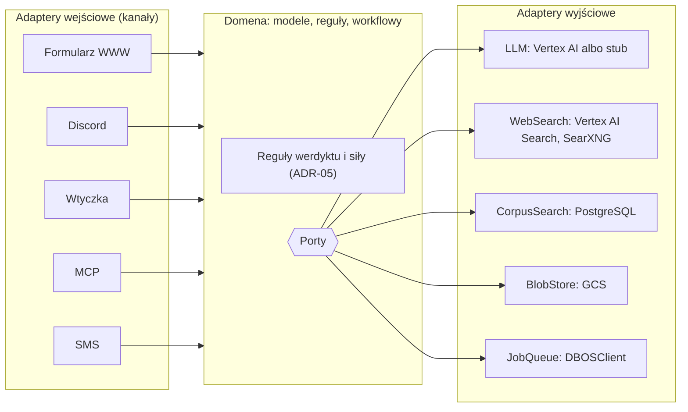

# Porty i adaptery

Kod dzielimy najpierw według domeny, a w każdej domenie stosujemy architekturę heksagonalną ([ADR-01](../adr/adr-01.md)). Wiążące zasady są w skillu `meritum-architecture` w repozytorium zbiorczym (`.claude/skills/meritum-architecture/SKILL.md`). Ta strona je streszcza.

## Pionowe wycinki

Domeny to `checks`, `channels`, `evidence`, `corpus`, `security`, `moderation`, `observability` i `notifications`, a do tego `jobs` (obsługa DBOS) i `shared` tylko dla kodu, którego używają co najmniej trzy domeny. Każda domena ma te same nazwy plików:

```text
src/meritum_core/evidence/
  __init__.py          # publiczne API domeny: tylko re-eksporty
  constants.py
  models.py
  ports.py
  factory.py
  adapters/            # jeden prywatny moduł na dostawcę
    __init__.py
    _vertex.py
    _stub.py
  errors.py
```

Domena importuje inną tylko przez jej pakiet. Prywatne moduły, funkcje i stałe zaczynają się od `_` i nikt spoza pakietu ich nie importuje.

## Porty, adaptery i fabryki

Każda zależność zewnętrzna stoi za portem: model językowy, embeddingi, wyszukiwanie w sieci, transkrypcja, pobieranie stron, magazyn plików, logowanie, wysyłka powiadomień i baza incydentów. Port to `typing.Protocol` w `<domena>/ports.py` (w TypeScripcie `interface` w `ports.ts`) i mówi modelami domeny, nigdy typami SDK dostawcy. Każdy dostawca to adapter w `<domena>/adapters/`. Adapter buduje tylko fabryka w `<domena>/factory.py`, na podstawie ustawień.



Dzięki temu nowy kanał, model albo dostawca to nowy adapter, a domenę testujemy bez sieci, na adapterze `stub` albo na atrapie zgodnej z protokołem. Porty z dokumentów decyzji: `WebSearch` ([ADR-07](../adr/adr-07.md)), `CorpusSearch` ([ADR-32](../adr/adr-32.md)), `BlobStore` ([ADR-31](../adr/adr-31.md)) i `JobQueue` z `DbosJobQueue` w meritum-core. Klasyfikatory przed modelem (wstrzyknięcia, reranker, maskowanie danych) też stoją za portami, każdy z adapterem zapasowym, który nic nie robi, więc awaria bramki nie zatrzymuje sprawdzeń ([ADR-35](../adr/adr-35.md)).

## Kontrakty w jednym miejscu

Kontrakty danych żyją tylko w meritum-core, w `meritum_core.checks.contracts` ([ADR-02](../adr/adr-02.md)). Z nich CI core generuje `contracts/meritum.schema.json` i `contracts/meritum.ts`. Design system i aplikacje w TypeScripcie trzymają kopie tych plików i nigdy ich nie edytują. Backend i worker przypinają konkretny commit core w `uv.lock` ([ADR-33](../adr/adr-33.md)). [Referencja kontraktów](../referencja/kontrakty.md) powstaje z JSON Schema.

## Co pilnuje zasad

| Zasada | Kontrola |
|---|---|
| wycinki i prywatne `_nazwy` | pytestarch w `tests/architecture/`, `scripts/check_conventions.py`; w TypeScripcie dependency-cruiser |
| domena nie importuje adapterów ani frameworków | pytestarch `test_hexagonal.py`; dependency-cruiser `adapters-only-from-factory` |
| lintery na pełną moc | ruff z `select = ["ALL"]` i `ty` w trybie strict; Biome i `tsc` w trybie strict |
| docstringi z identyfikatorami funkcji (`US-…`, `F-…`, `ADR-…`) | ruff `D` i `DOC`, `scripts/check_conventions.py`, test JSDoc w TypeScripcie |
| najwyżej 250 linii na plik | `scripts/check_conventions.py`, test długości plików |
| martwy kod i bezpieczeństwo | vulture, bandit, knip |

Wyjątek od reguły jest wąski i zawsze ma powód zapisany obok, w kodzie albo w `pyproject.toml`. Każde repozytorium z kodem opisuje swoje kontrole w `docs/architecture.md`.
