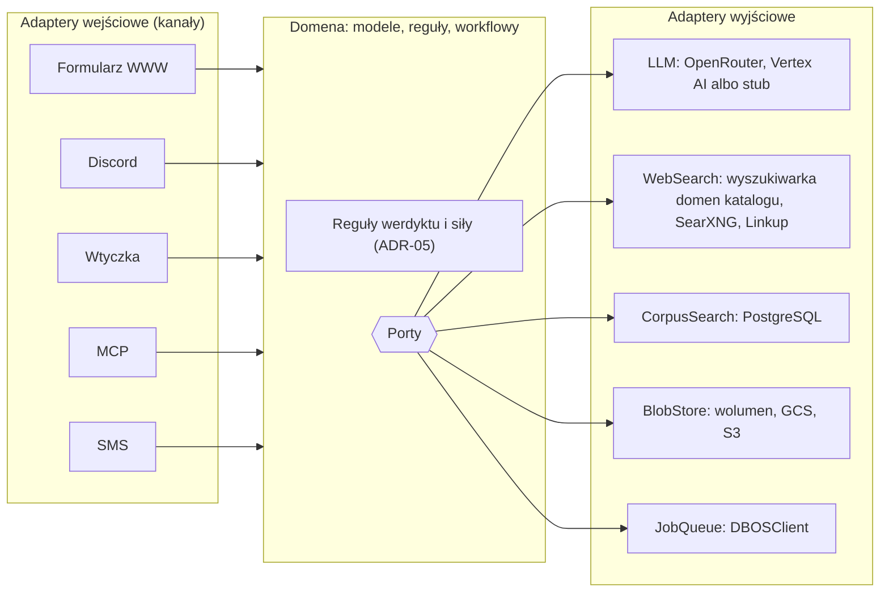

# Porty i adaptery

Kod dzielimy najpierw według domeny, a w każdej domenie stosujemy architekturę heksagonalną ([ADR-01](../adr/adr-01.md)). Wiążące zasady są w skillu `meritum-architecture` w repozytorium zbiorczym (`.claude/skills/meritum-architecture/SKILL.md`). Ta strona je streszcza.

## Pionowe wycinki

Domeny to `checks`, `channels`, `evidence`, `corpus`, `security`, `moderation`, `observability` i `notifications`, a do tego `jobs` (obsługa DBOS) i `shared` tylko dla kodu, którego używają co najmniej trzy domeny. Każda domena ma te same nazwy plików:

```text
src/meritum_core/evidence/
  __init__.py          # publiczne API domeny: tylko re-eksporty
  constants.py
  models.py
  ports.py
  factory.py
  adapters/            # jeden prywatny moduł na dostawcę
    __init__.py
    _vertex.py
    _stub.py
  errors.py
```

Domena importuje inną tylko przez jej pakiet. Prywatne moduły, funkcje i stałe zaczynają się od `_` i nikt spoza pakietu ich nie importuje.

## Porty, adaptery i fabryki

Każda zależność zewnętrzna stoi za portem: model językowy, embeddingi, reranker, wyszukiwanie w sieci i w korpusie, transkrypcja, OCR, pobieranie stron, maskowanie, bramka wstrzyknięć, magazyn plików i wysyłka powiadomień. Port to `typing.Protocol` w `<domena>/ports.py` (w TypeScripcie `interface` w `ports.ts`) i mówi modelami domeny, nigdy typami SDK dostawcy. Każdy dostawca to adapter w `<domena>/adapters/`. Adapter buduje tylko fabryka w `<domena>/factory.py`, na podstawie ustawień.



Poniższe porty mają implementacje w [meritum-core](https://github.com/Meritum-HackNation2026/meritum-core/blob/main/README.md). Wybór adaptera zależy od ustawień, więc testy mogą korzystać z atrap bez dostępu do usług zewnętrznych.

| Port | Co obsługuje |
|---|---|
| `LlmPort` | Model językowy zwraca odpowiedź zgodną z modelem Pydantic i zużycie tokenów z kosztem. Port przyjmuje też definicje narzędzi i zwraca ich wywołania. Adaptery: OpenRouter (domyślnie Claude Haiku 5.5, endpointy ZDR, rozumowanie z konfiguracji), Vertex AI (Gemini) i stub. Awaria dostawcy to `ProviderUnavailableError`, a workflow zamienia ją w „Problem techniczny”. |
| `EmbeddingsPort` | Wektory 768-wymiarowe z Vertex AI w regionie UE albo stub. Korpus i zapytania muszą używać tego samego modelu. |
| `CorpusSearchPort`, `RerankerPort` | Wyszukiwanie hybrydowe w przypiętej migawce korpusu (adapter PostgreSQL i pamięć) oraz opcjonalny reranker (Vertex AI ranking API, Cloudflare Workers AI albo Cohere przez OpenRouter). Bez rerankera kolejność zostaje z wyszukiwania. |
| `WebSearchPort` | Wyszukiwanie na żywo wyłącznie w domenach katalogu. Port nie pobiera stron. Zapasowe adaptery: własna instancja SearXNG i opcjonalny Linkup. |
| `TranscriptionPort`, `OcrPort`, `ImageSearchPort` | Transkrypcja (Speech-to-Text v2, Chirp 3, multi-region `eu`), odczyt tekstu z obrazu (Cloud Vision, endpoint UE) i wyszukiwanie wcześniejszych wystąpień obrazu lub jawne „nie wyszukano”. Każdy ma stub. |
| `BlobStore` | Pliki audio i obrazy. API zapisuje plik i zwraca identyfikator, po którym worker go odczytuje. Adaptery: system plików, prywatny bucket GCS, magazyn zgodny z S3 i atrapa w pamięci ([ADR-31](../adr/adr-31.md)). |
| `PageFetcherPort`, `PiiGatePort`, `InjectionGatePort` | Fetcher pobiera publiczne strony HTTP(S), blokuje adresy wewnętrzne także po przekierowaniu, respektuje robots.txt i Content-Signal, a strony wymagające JavaScriptu renderuje lokalny Crawl4AI. Maskowanie łączy bramkę Google Sensitive Data Protection z regułami dla telefonów, e-maili i numerów dokumentów. Bramka wstrzyknięć to Model Armor albo Llama Guard w Cloudflare Workers AI; bez niej działają wzorce PL/EN i izolowany klasyfikator. |
| `JobQueue` | Backend zleca zadania i czyta strumień postępu. Adapter `DbosJobQueue` używa `DBOSClient`, a testy mogą korzystać z `InMemoryJobQueue`. |

Zapisy sprawdzeń, sprawy moderatorów, tematy wysokiego ryzyka, powiadomienia, konta personelu, przebiegi i zestawy ewaluacji mają osobne porty repozytoriów, a `SubjectEraser` usuwa jedną osobę ze wszystkich tabel. API i worker mogą korzystać z adapterów PostgreSQL, a lokalnie i w testach mają do dyspozycji atrapy w pamięci. [Układ bazy i migracje](../wdrozenie.md#migracje) opisuje strona o wdrożeniu.

## Kontrakty w jednym miejscu

Meritum-core utrzymuje kontrakt sprawdzania w `meritum_core.checks.contracts` ([ADR-02](../adr/adr-02.md)). Z niego powstają JSON Schema i typy TypeScript, których kopie odświeżają design system i frontend. Backend i worker przypinają konkretny commit core w `uv.lock` ([ADR-33](../adr/adr-33.md)). Kontrakt jest w wersji 18, a zmiany wersji od 4 opisuje strona [Sprawdzenie krok po kroku](../jak-dziala/sprawdzenie.md#kontrakt).

`meritum_core.jobs.contracts` ma własne wersjonowanie. Określa nazwy, kolejki oraz wejścia i wyniki workflowów sprawdzania, eskalacji, usuwania danych, raportu gotowości, przebiegu ewaluacji (`eval_run`), archiwizacji strony (`archive_page`) i zadania testowego `ping`.

## Co pilnuje zasad

| Zasada | Kontrola |
|---|---|
| wycinki i prywatne `_nazwy` | pytestarch w `tests/architecture/`, `scripts/check_conventions.py`; w TypeScripcie dependency-cruiser |
| domena nie importuje adapterów ani frameworków | pytestarch `test_hexagonal.py`; dependency-cruiser `adapters-only-from-factory` |
| lintery na pełną moc | ruff z `select = ["ALL"]` i `ty` w trybie strict; Biome i `tsc` w trybie strict |
| docstringi z identyfikatorami funkcji (`US-…`, `F-…`, `ADR-…`) | ruff `D` i `DOC`, `scripts/check_conventions.py`, test JSDoc w TypeScripcie |
| najwyżej 250 linii na plik | `scripts/check_conventions.py`, test długości plików |
| martwy kod i bezpieczeństwo | vulture, bandit, knip |

Wyjątek od reguły jest wąski i zawsze ma powód zapisany obok, w kodzie albo w `pyproject.toml`. Każde repozytorium z kodem opisuje swoje kontrole w `docs/architecture.md`.

W core, backendzie i workerze `uv run behave` uruchamia scenariusze z `features/`. Skan sekretów (gitleaks) sprawdza w każdym repozytorium tylko historię pushowanej gałęzi. Domyślny przebieg pytest pomija testy z markerem `integration`. Frontend, wtyczka i makiety uruchamiają `node --test` przez `pnpm test`. `tsx` ładuje komponenty TSX, a happy-dom zapewnia DOM.
