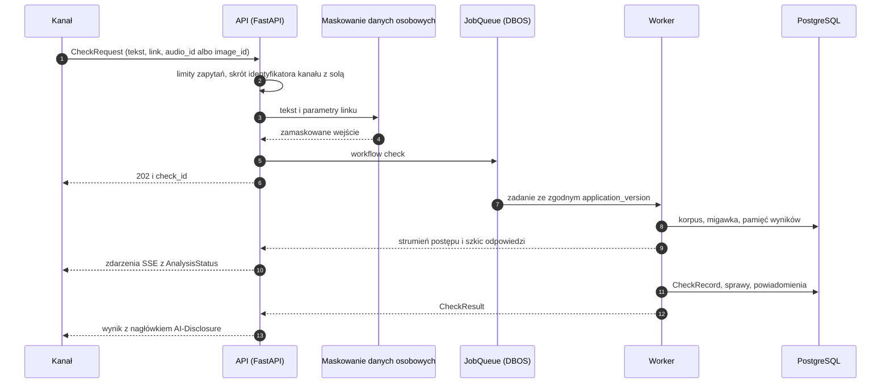
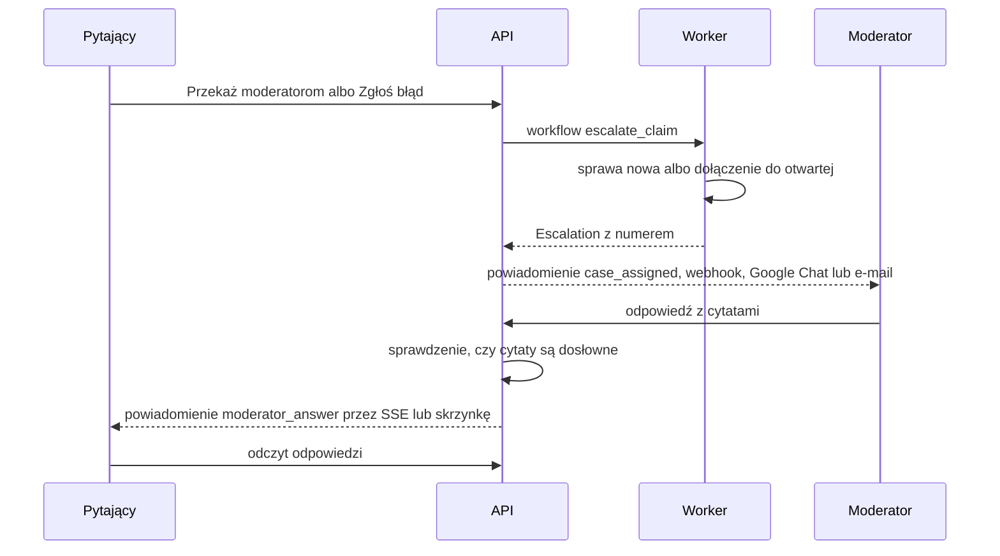

# Przepływ danych

Strona pokazuje, którędy przechodzi pytanie, zanim stanie się wynikiem, i co zostaje w bazie. Kroki samego sprawdzenia opisuje [Sprawdzenie krok po kroku](../jak-dziala/sprawdzenie.md).

## Od kanału do wyniku

1. **Kanał.** Formularz i wtyczka podają losowy identyfikator sesji w nagłówku `X-Meritum-Session`. Discord, SMS i MCP nie mają sesji, więc adapter podaje identyfikator kanału (`channel_user_id`), a API od razu zamienia go w skrót HMAC-SHA-256 z solą. Surowy identyfikator nie trafia do kolejki, bazy ani logów.
2. **Pliki.** Nagranie (`POST /api/v1/audio`) i zrzut ekranu (`POST /api/v1/images`) trafiają do `BlobStore` z terminem ważności 30 dni. Żądanie sprawdzenia niesie tylko ich identyfikator.
3. **Maskowanie.** API maskuje telefony, e-maile, PESEL, numery dowodów, paszportów, kont i kart w tekście oraz w parametrach adresu. Najpierw działa bramka Google Sensitive Data Protection w UE, potem wzorce z meritum-core. Kwoty i nazwiska osób publicznych zostają, bo bez nich nie da się sprawdzić twierdzenia.
4. **Kolejka.** API sprawdza, ile sprawdzeń czeka w środowisku, i przy progu odpowiada 429. Potem zleca workflow `check` przez `DBOSClient`.
5. **Worker.** Czyta plik z `BlobStore`, transkrybuje albo odczytuje obraz, pobiera stronę z linku, skanuje treść pod kątem poleceń, wyodrębnia twierdzenia i prowadzi trzy badania naraz: w korpusie, w sieci i u fact-checkerów. Wynik każdego kroku, który DBOS zapisuje, jest zamaskowany.
6. **Postęp.** Workflow publikuje kolejne `AnalysisStatus` w strumieniu. API przekazuje je jako zdarzenia SSE. Rozłączenie klienta nie przerywa workflowu, a ponowne połączenie odtwarza kroki od początku.
7. **Wynik.** Worker zapisuje `CheckRecord` (zamaskowane pytanie, kanał, źródła, werdykty, użyte modele, koszt, region, zdarzenia wstrzyknięć) i zwraca `CheckResult`. Pamięć wyników trzyma tylko część merytoryczną i nigdy nie zapamiętuje problemu technicznego.

## Gdzie co leży

| Dane | Miejsce | Kto pisze | Retencja |
|---|---|---|---|
| zapisy sprawdzeń, sprawy, powiadomienia, konta personelu, przebiegi ewaluacji | schemat `app_<env>` bazy `meritum` | worker (właściciel), API | 30 dni dla zapisów i powiadomień |
| stan workflowów | baza `meritum_dbos_<env>` | DBOS | 30 dni |
| korpus, fragmenty, migawki, kopia EUvsDisinfo | schemat `corpus` | tylko worker prd | pełne teksty 90 dni |
| nagrania i obrazy | wolumen plików, docelowo prywatny bucket | API zapisuje, worker czyta | najdłużej jak zapis sprawdzenia |
| liczniki limitów | tabela `rate_limit_hits` w schemacie API | API | do końca okna limitu |
| jednorazowe linki jury, konfiguracja powiadomień | schemat API | API | do wygaśnięcia linku |

Workflow `retention` startuje co godzinę i usuwa wygasłe zapisy razem z powiadomieniami, miejscem w sprawach i workflowami DBOS. Szczegóły ról i migracji są w [Wdrożenie i uruchomienie](../wdrozenie.md#migracje).

## Odpowiedź moderatora

Szczegóły są w [Moderacja i odpowiedzi](../jak-dziala/moderacja.md).

## Usuwanie danych

„Usuń moje sprawdzenia” (sesja przeglądarki albo wtyczki), `/usun-moje-dane` (Discord), słowo `USUN` (SMS) i usunięcie konta wołają ten sam mechanizm. API najpierw zleca workflow `delete_subject`: worker anuluje działające sprawdzenia, usuwa dane workflowów w tabelach DBOS oraz pliki. Potem API w jednej transakcji usuwa zapisy, powiadomienia i powiązania ze sprawami. Sprawa zostaje dla innych pytających. Po minucie worker przechodzi usuwanie drugi raz, żeby zebrać zapis, który zdążył zapisać krok trwający w chwili anulowania.
