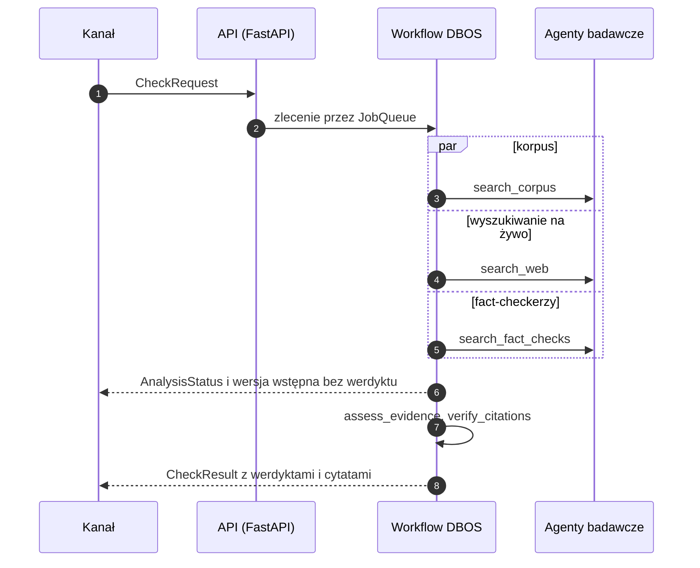

# Sprawdzenie krok po kroku

API przyjmuje `CheckRequest` i zleca workerowi sprawdzenie przez `JobQueue`. Worker wykonuje zadanie jako workflow DBOS `check` ([ADR-03](../adr/adr-03.md)). Klient może odczytać `AnalysisStatus` po identyfikatorze sprawdzenia albo śledzić kolejne zdarzenia w strumieniu. Jeśli workflow zwróci `CheckResult`, klient dostanie go przed zamknięciem strumienia. Szczegóły punktów końcowych opisuje [README backendu](https://github.com/Meritum-HackNation2026/meritum-backend/blob/develop/README.md).

## Kontrakt v4

Wersja 4 przewiduje pole `transcript` na zamaskowaną transkrypcję nagrania. Sam krok transkrypcji w workflow `check` czeka na podłączenie do workera. Dla Discorda, SMS-a i MCP kontrakt przewiduje pole `channel_user_id`. API ma zapisywać wyłącznie jego skrót z solą (`channel_user_hash`). Obecnie punkt końcowy `POST /api/v1/checks` odrzuca żądania z tych trzech kanałów.

Wynik ma osobne kody awarii (`failure_code`) i ograniczeń (`limitation_codes`). Przy dopasowaniu do znanego incydentu `match_basis` podaje podstawę dopasowania. W wyniku dla twierdzenia `would_change_verdict` wskazuje, czego brakuje do zmiany werdyktu. Kontrakt rozróżnia oceny fact-checkerów pokazane jako kontekst (`claim_reviews`) i oceny wykorzystane jako przesłanki (`claim_review_premises`). Przesłanką może być ocena ClaimReview fact-checkera z IFCN lub EFCSN podana z linkiem, bez cytowania treści jego strony ([ADR-34](../adr/adr-34.md)).

Pola wersji 4 opisuje [zmiana kontraktu w meritum-core](https://github.com/Meritum-HackNation2026/meritum-core/pull/63). Dalsze sekcje przedstawiają docelowy przebieg sprawdzenia z dokumentu produktowego.

## Kroki

Kody kroków pochodzą z kontraktu (`AnalysisStep.code`), a ich nazwy z `copy/pl.json` w design systemie. Te same nazwy widzi użytkownik na pasku analizy.

| Kod | Co widzi użytkownik | Kiedy |
|---|---|---|
| `receive` | Przyjmujemy pytanie | zawsze |
| `fetch_url` | Pobieramy stronę z linku | tylko gdy wklejono link; przy samym tekście krok jest pominięty |
| `transcribe_audio` | Zamieniamy nagranie na tekst | tylko dla pliku audio albo wiadomości głosowej |
| `screen_injection` | Sprawdzamy, czy treść nie zawiera ukrytych poleceń | zawsze, przed każdym wywołaniem modelu |
| `extract_claims` | Wyodrębniamy twierdzenia do sprawdzenia | zawsze; najwyżej 5 twierdzeń, opinie osobno od faktów |
| `search_corpus` | Szukamy w bazie źródeł | równolegle z dwoma kolejnymi |
| `search_web` | Szukamy świeżych publikacji w zatwierdzonych serwisach | zawsze, tylko w domenach z katalogu |
| `search_fact_checks` | Szukamy ustaleń fact-checkerów | równolegle z korpusem |
| `assess_evidence` | Porównujemy źródła z twierdzeniami | po zebraniu dowodów |
| `verify_citations` | Sprawdzamy, czy cytaty są dosłowne | przed pokazaniem werdyktu |
| `write_answer` | Piszemy odpowiedź prostym językiem | na końcu |
| `save_record` | Zapisujemy przebieg sprawdzenia | na końcu, także po awarii |

Każdy krok ma stan: czeka, w toku, gotowe, pominięte albo nieudane (`pending`, `active`, `done`, `skipped`, `failed`).

## Badania idą równolegle

Po wyodrębnieniu twierdzeń trzy agenty badawcze działają osobno i naraz: korpus, wyszukiwanie na żywo i fact-checkerzy ([ADR-20](../adr/adr-20.md)). Wyszukiwanie w sieci rusza przy każdym sprawdzeniu, razem z korpusem. Próg wyszukiwania decyduje tylko o tym, czy odpowiedź czeka na jego wynik ([ADR-07](../adr/adr-07.md)). Wyszukiwanie ma limit 10 s.

Agent główny strumieniuje kolejne wersje odpowiedzi razem z postępem badań. Wersja wstępna ma dopisek „Wersja wstępna. Werdykt pokażemy po sprawdzeniu cytatów.” i nie pokazuje werdyktu, dopóki cytaty nie przejdą weryfikacji ([ADR-06](../adr/adr-06.md)).

## Czas

Treść zadania MSZ wymaga mediany do 30 s. Zespół optymalizuje pod ostrzejszy cel: najwyżej 30 s na każde sprawdzenie tekstu albo linku. Po 30 s system niczego nie przerywa i nie zmienia wyniku. Czas liczymy z zapisu przebiegu, od `received_at` do `answered_at`.

## Ten sam wynik w każdym kanale

Wynik trafia do pamięci wyników pod kluczem ze znormalizowanego wejścia i żyje tam stały czas, na przykład 2 godziny, niezależnie od nowych migawek korpusu ([ADR-19](../adr/adr-19.md)). Pamięć trzyma tylko część merytoryczną ([ADR-22](../adr/adr-22.md)): twierdzenia, ograniczenia, wersję korpusu i identyfikatory cytowanych źródeł. Przekazanie sprawy moderatorom i licznik powtórzeń są liczone przy każdym zapytaniu, a problemu technicznego nigdy nie zapamiętujemy. Model działa z temperaturą 0 i przypiętą wersją.

## Polecenia ukryte w treści

Treść od użytkownika, podany przez niego link i teksty źródeł trafiają do modelu wyłącznie jako dane ([ADR-12](../adr/adr-12.md)). Polecenie wykryte w treści użytkownika jest wycinane, a resztę system analizuje dalej. Źródło z poleceniem wypada z dowodów. Każda próba trafia do zapisu przebiegu jako `InjectionEvent` ([ADR-23](../adr/adr-23.md)).
