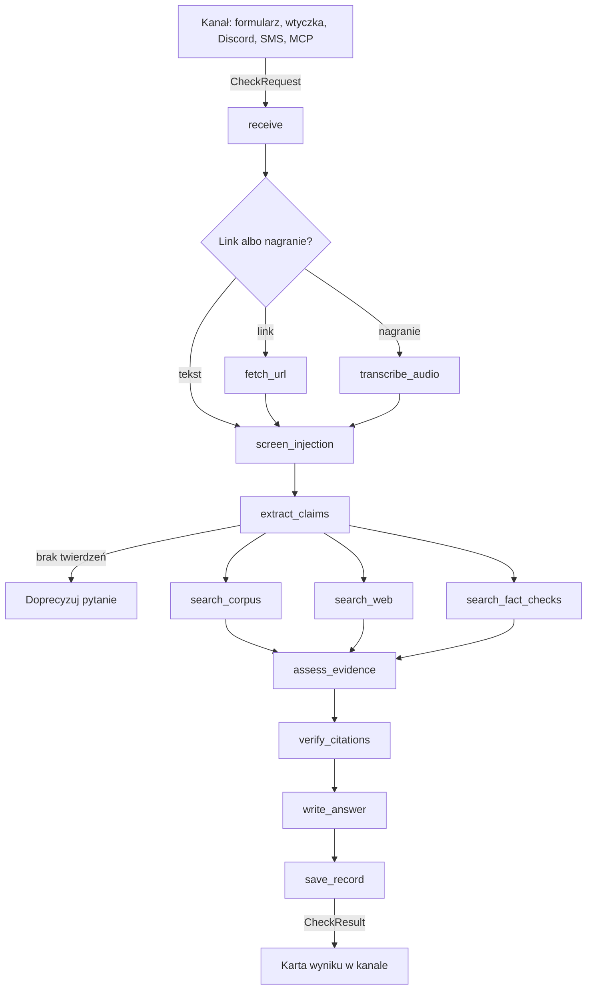
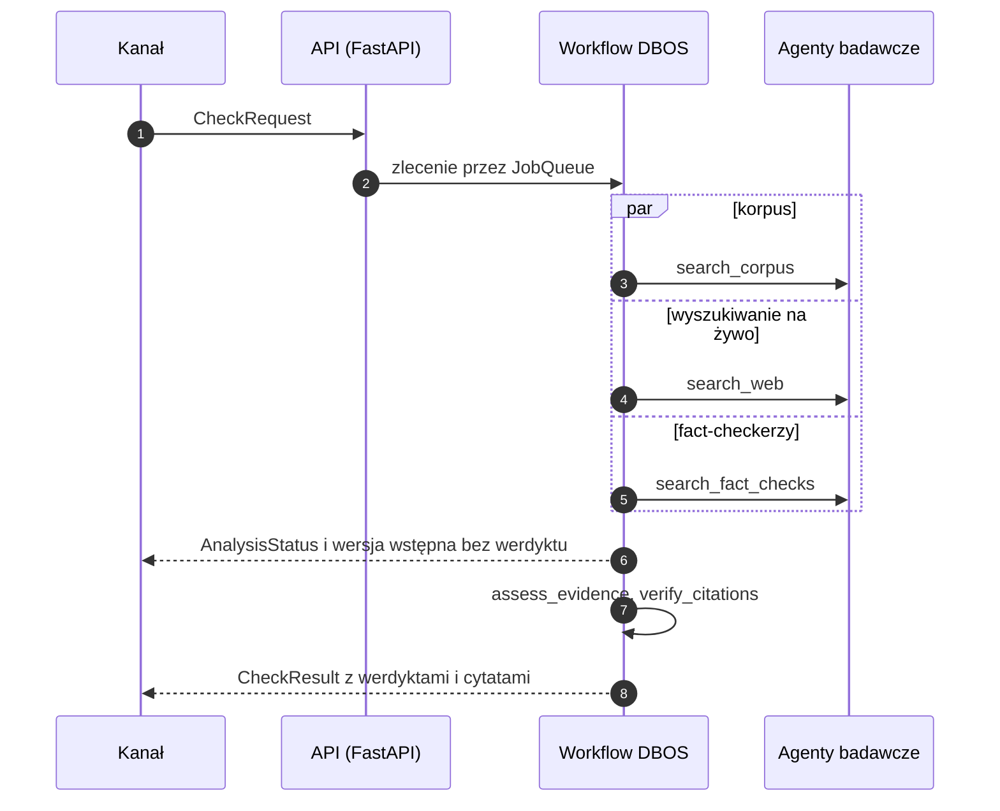

# Sprawdzenie krok po kroku

Kanały wysyłają do API to samo `CheckRequest`. API maskuje dane osobowe, liczy limity i zleca workerowi sprawdzenie przez `JobQueue`. Worker wykonuje je jako workflow DBOS `check` ([ADR-03](../adr/adr-03.md)). Klient czyta `AnalysisStatus` po identyfikatorze sprawdzenia albo śledzi zdarzenia w strumieniu SSE. Gdy workflow zwróci `CheckResult`, klient dostaje go przed zamknięciem strumienia. Droga danych między komponentami jest na stronie [Przepływ danych](../architektura/przeplyw-danych.md), a punkty końcowe w [README backendu](https://github.com/Meritum-HackNation2026/meritum-backend/blob/develop/README.md).

## Co można wysłać

| Wejście | Jak trafia do sprawdzenia | Ograniczenia |
|---|---|---|
| Tekst | pole `text` | do 4000 znaków |
| Link | pole `url`; worker pobiera stronę (krok `fetch_url`) | tylko http(s); adresy wewnętrzne są blokowane także po przekierowaniu; link z loginem lub hasłem dostaje 422 |
| Nagranie | API zapisuje plik w `BlobStore` i zwraca `audio_id`; worker transkrybuje go Chirpem 3 w multi-regionie `eu` | OGG Opus, MP3, M4A albo WAV, do 20 MiB i 10 minut; nagranie dłuższe niż 55 s idzie w trybie batch i kończy się powiadomieniem |
| Zrzut ekranu | API zapisuje obraz i zwraca `image_id`; worker czyta tekst przez OCR (Cloud Vision, endpoint UE) | PNG, JPEG, WebP do 10 MiB; `image_id` wyklucza `text`, `url` i `audio_id` |

Odczytany tekst z nagrania albo obrazu jest maskowany i sprawdzany jak wklejony. Karta wyniku pokazuje transkrypcję z ostrzeżeniem o możliwych błędach albo tekst odczytany z obrazu. Data zapisana na obrazie datuje twierdzenia, ale nie potwierdza daty publikacji, o czym mówi ograniczenie w odpowiedzi. Wyszukiwania wcześniejszych wystąpień obrazu jeszcze nie ma i wynik mówi o tym kodem ograniczenia `image_search_not_run`. Nieobsługiwany format albo za duży plik daje stan „Poza zakresem” z komunikatem, co wysłać zamiast. Obraz bez tekstu daje „Doprecyzuj pytanie”.

## Kontrakt

Kontrakt sprawdzania jest w wersji 18. Zmienia się tylko w meritum-core ([ADR-02](../adr/adr-02.md)), a każda zmiana niezgodna wstecz podnosi wersję. Rdzeń nowszego kontraktu da się odczytać starszym kodem: kolejka i zapisy sprawdzeń ignorują nieznane pola. Co przyniosły kolejne wersje:

| Wersje | Zmiana |
|---|---|
| 4–5 | pole `transcript` na zamaskowaną transkrypcję; `channel_user_id` dla Discorda, SMS-a i MCP, z którego API zapisuje tylko skrót z solą (`channel_user_hash`); opcjonalny `session_id` w `CheckRequest` |
| 6 | `ai_marker` w wyniku: który system AI napisał uzasadnienie, z którym modelem i kiedy. API dodaje go do nagłówka `AI-Disclosure` |
| 7–8 | kody dla nagrań i dla wejścia poza zakresem (`out_of_scope_code`), żeby karta mówiła, czego nie obsługujemy |
| 9–10 | powiadomienie niesie `step_code` przy postępie i `message_code` przy komunikacie systemowym; tekst składa aplikacja z `copy/pl.json`. Kontrakt ma też `EvalRun`: wyniki przypadków i powiadomienie o końcu przebiegu |
| 11 | każde ograniczenie ma własny kod (`limitation_codes`) |
| 12 | dowód przeterminowany nie tworzy rozbieżności |
| 13 | `AnalysisStatus` może nieść `draft`, czyli zamaskowany szkic odpowiedzi do strumieniowania; szkic nie jest werdyktem |
| 14 | pozycja katalogu może ustawić `max_age_hours`, krótszy próg wieku dowodu |
| 15 | żądanie przyjmuje `image_id`; wynik niesie tekst odczytany z obrazu |
| 16–17 | `Premises` ma `signatory_reviews`: liczbę sygnatariuszy IFCN lub EFCSN, których ocena zgadza się z werdyktem |
| 18 | `kind_by_path` w katalogu: rodzaj źródła po ścieżce adresu, na przykład stenogram Sejmu ma własny rodzaj zamiast aktu prawnego |

Kontrakt zadań (`meritum_core.jobs.contracts`) ma osobne wersjonowanie. Obejmuje workflowy `ping`, `check`, `escalate_claim`, `delete_subject`, `readiness`, `eval_run` i `archive_page`.

W `CheckResult` kod awarii (`failure_code`) jest wymagany przy stanie `technical_failure` i musi być pusty przy pozostałych. Każdy `ClaimResult` ma datę twierdzenia (`claim_date`) i jej źródło (`claim_date_source`). `match_basis` podaje podstawę dopasowania do znanego incydentu, a `would_change_verdict` wskazuje, czego brakuje do zmiany werdyktu. Tę ostatnią informację liczy reguła z werdyktu, przesłanek i braków, a nie model. Kontrakt odróżnia oceny fact-checkerów pokazane jako kontekst (`claim_reviews`) od ocen użytych jako przesłanki (`claim_review_premises`). Przesłanką może być ocena ClaimReview fact-checkera z IFCN lub EFCSN, podana z linkiem i bez cytowania jego strony ([ADR-34](../adr/adr-34.md)). Każdy wynik niesie też znacznik czytelny maszynowo, że uzasadnienie napisał system AI.

## Kroki

Kody kroków pochodzą z kontraktu (`AnalysisStep.code`), a ich nazwy z `copy/pl.json` w design systemie. Te same nazwy widzi użytkownik na pasku analizy.

| Kod | Co widzi użytkownik | Kiedy |
|---|---|---|
| `receive` | Przyjmujemy pytanie | zawsze; dla zrzutu ekranu obejmuje odczyt tekstu z obrazu (OCR) |
| `fetch_url` | Pobieramy stronę z linku | tylko gdy wklejono link; przy samym tekście krok jest pominięty |
| `transcribe_audio` | Zamieniamy nagranie na tekst | tylko dla pliku audio albo wiadomości głosowej |
| `screen_injection` | Sprawdzamy, czy treść nie zawiera ukrytych poleceń | zawsze, przed każdym wywołaniem modelu |
| `extract_claims` | Wyodrębniamy twierdzenia do sprawdzenia | zawsze; najwyżej 5 twierdzeń, opinie osobno od faktów |
| `search_corpus` | Szukamy w bazie źródeł | równolegle z dwoma kolejnymi |
| `search_web` | Szukamy świeżych publikacji w zatwierdzonych serwisach | zawsze, tylko w domenach z katalogu |
| `search_fact_checks` | Szukamy ustaleń fact-checkerów | równolegle z korpusem |
| `assess_evidence` | Porównujemy źródła z twierdzeniami | po zebraniu dowodów |
| `verify_citations` | Sprawdzamy, czy cytaty są dosłowne | przed pokazaniem werdyktu |
| `write_answer` | Piszemy odpowiedź prostym językiem | na końcu |
| `save_record` | Zapisujemy przebieg sprawdzenia | na końcu, także po awarii |

Każdy krok ma stan: czeka, w toku, gotowe, pominięte albo nieudane (`pending`, `active`, `done`, `skipped`, `failed`).

## Badania idą równolegle

Po wyodrębnieniu twierdzeń trzy agenty badawcze działają osobno i naraz: korpus, wyszukiwanie na żywo i fact-checkerzy ([ADR-20](../adr/adr-20.md)). Wyszukiwanie w sieci rusza przy każdym sprawdzeniu, razem z korpusem. Próg wyszukiwania decyduje tylko o tym, czy odpowiedź czeka na jego wynik ([ADR-07](../adr/adr-07.md)). Wyszukiwanie ma limit 10 s. Zapytania do wyszukiwarki powstają ze słów kluczowych twierdzenia, po polsku i po angielsku, a odpowiedź jest zawsze po polsku. Fragmenty z korpusu porządkuje opcjonalny reranker, którego awaria nie przerywa sprawdzenia: kolejność zostaje z wyszukiwania.

Agent główny strumieniuje kolejne wersje odpowiedzi razem z postępem badań. Wersja wstępna (pole `draft`) ma dopisek „Wersja wstępna. Werdykt pokażemy po sprawdzeniu cytatów.” i nie pokazuje werdyktu, dopóki cytaty nie przejdą weryfikacji ([ADR-06](../adr/adr-06.md)).

## Model i ocena dowodów

Model działa przez port `LlmPort`: domyślnie Claude Haiku 5.5 przez OpenRouter, z endpointami bez retencji danych (ZDR). Konfiguracja wybiera dostawcę, model, region i poziom rozumowania, więc zmiana modelu nie wymaga przebudowy ([ADR-11](../adr/adr-11.md)). Wymowę każdego cytatu (wspiera, obala, daje kontekst) ocenia osobne wywołanie, które widzi tylko parę twierdzenie i źródło. Werdykt i siłę liczy potem reguła z meritum-core, według [Werdykty i reguły](werdykty.md). Tekst dla obywatela mówi o źródłach prostym językiem i nie zawiera nazw kodów werdyktu. Gdy model zwróci za długi tekst, worker skraca go do limitu kontraktu.

## Ostrzeżenia obok wyniku

Worker dodaje do wyniku neutralne ostrzeżenie, gdy treść pochodzi od podmiotu z listy sankcji UE, oraz dopasowanie do znanych incydentów. Częściowe potwierdzenie twierdzenia nie daje werdyktu „Potwierdzone”. Względne daty w artykule („wczoraj”) liczą się od dnia publikacji strony, a data z przyszłości jest pomijana. Twierdzenie bez daty z artykułu pod linkiem dostaje datę publikacji strony.

## Powiadomienia i postęp

Workflow zapisuje powiadomienia z retencją 30 dni: `check_progress` (kod kroku), `check_done` (po długim nagraniu), `moderator_answer` (odpowiedź moderatora), `new_evidence` i `system`. Trafiają do sesji albo konta przez SSE i czekają w skrzynce, jeśli odbiorca był poza stroną. Szczegóły odpowiedzi moderatora są w [Moderacja i odpowiedzi](moderacja.md).

## Gdy dostawca zawiedzie

Niedostępny dostawca, brak klucza albo przekroczony limit kończą sprawdzenie stanem „Problem techniczny” z kodem awarii, a nie werdyktem. Niedostępny dostawca pomocniczy, na przykład baza EUvsDisinfo, nie blokuje sprawdzeń: log mówi, że działamy w stanie obniżonym, i podaje przyczynę. Nieczytelna odpowiedź bramki wstrzyknięć pomija bramkę, a wzorce z meritum-core działają dalej. Co robić po stronie operatora, opisują [Runbooki](../runbooki.md).

## Czas

Treść zadania MSZ wymaga mediany do 30 s. Zespół optymalizuje pod ostrzejszy cel: najwyżej 30 s na każde sprawdzenie tekstu albo linku. Po 30 s system niczego nie przerywa i nie zmienia wyniku. Czas liczymy z zapisu przebiegu, od `received_at` do `answered_at`.

## Ten sam wynik w każdym kanale

Wynik trafia do pamięci wyników pod kluczem ze znormalizowanego wejścia i żyje tam stały czas, na przykład 2 godziny, niezależnie od nowych migawek korpusu ([ADR-19](../adr/adr-19.md)). Pamięć trzyma tylko część merytoryczną ([ADR-22](../adr/adr-22.md)): twierdzenia, ograniczenia, wersję korpusu i identyfikatory cytowanych źródeł. Przekazanie sprawy moderatorom i licznik powtórzeń są liczone przy każdym zapytaniu, a problemu technicznego nigdy nie zapamiętujemy. Model działa z temperaturą 0 i przypiętą wersją.

## Polecenia ukryte w treści

Każde wywołanie modelu przechodzi przez detektor wstrzyknięć. Treść od użytkownika, podany przez niego link i teksty źródeł trafiają do modelu wyłącznie jako dane ([ADR-12](../adr/adr-12.md)). Polecenie wykryte w treści użytkownika jest wycinane, a resztę system analizuje dalej. Źródło z poleceniem wypada z dowodów. Każda próba trafia do zapisu przebiegu jako `InjectionEvent` ([ADR-23](../adr/adr-23.md)).
