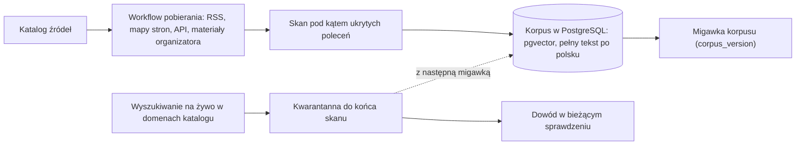

# Źródła i katalog

Meritum szuka dowodów tylko w jawnym katalogu źródeł. Katalog to lista domen, z których korzysta system. Każda pozycja (`CatalogEntry` w [kontraktach](../referencja/kontrakty.md#catalogentry)) ma:

- wydawcę z identyfikatorem `publisher_id`, według którego liczymy niezależne źródła;
- typ i poziom: urzędowe lub pierwotne (`primary`) albo wtórne (`secondary`);
- licencję albo podstawę prawną i wynik kontroli robots.txt oraz zastrzeżeń eksploracji tekstów i danych (TDM);
- sposób i częstotliwość odświeżania, ważność dokumentów i opcjonalny maksymalny wiek;
- powód kwalifikacji, a przy pozycji wykluczonej powód wykluczenia. Wykluczenie bez powodu nie przechodzi walidacji.

## Dwa typy źródeł

| Typ | Co obejmuje |
|---|---|
| Urzędowe i pierwotne | Serwisy gov.pl i agencji z listy organizatora (na przykład odyseusz.gov.pl, komunikaty RCB, policja.pl, moje.cert.pl), ISAP i EUR-Lex dla aktów prawnych, dane.gov.pl dla danych publicznych i strony BIP instytucji z katalogu. |
| Wtórne | Artykuły fact-checkerów fakenews.pl i pravda.org.pl (sygnatariusze IFCN) oraz teksty „fact” z EUvsDisinfo. |

Demagogu i AFP Sprawdzam nie pobieramy, bo blokują automaty. Konkret24 jest wykluczony: nie należy do IFCN ani EFCSN i wymaga umowy licencyjnej. Oceny ClaimReview z Google Fact Check Tools API, także tych fact-checkerów, służą do znajdowania adresów. Ocena fact-checkera z IFCN albo EFCSN może być przesłanką werdyktu: karta podaje wtedy nazwę fact-checkera, ocenę, tytuł, datę i link, bez fragmentu strony ([ADR-24](../adr/adr-24.md), [ADR-34](../adr/adr-34.md)).

Pełną ewidencję, czyli każde źródło z licencją, stanem kontroli robots.txt i tym, czego jeszcze brakuje, prowadzi sekcja „Ewidencja źródeł” w [dokumencie produktowym](https://github.com/Meritum-HackNation2026/meritum-design-system/blob/main/docs/product-doc.html).

## Korpus

Korpus powstaje z katalogu: dokumenty są pobierane, dzielone na fragmenty do 1200 znaków i wektoryzowane. Cel na hackathon to co najmniej 100 dokumentów z co najmniej 10 domen i obu typów. Wyszukiwanie jest hybrydowe: pgvector, wyszukiwanie pełnotekstowe ze słownikiem polskim i podobieństwo trigramów w PostgreSQL. Trzy rankingi łączy reciprocal rank fusion, a wynik waży świeżość liczona od daty twierdzenia, nie od dzisiaj ([ADR-04](../adr/adr-04.md)).

Do korpusu trafiają cztery rodzaje materiału:

- pozycje katalogu wczytywane z RSS, map stron i stron statycznych przez zaplanowany workflow `corpus_ingest` (co 15 minut; każda pozycja wedle własnej częstotliwości odświeżania). Pozycje wykluczone i zastrzeżone w TDM są pomijane;
- pozycje katalogu udostępniane przez publiczne API;
- materiały organizatora i baza incydentów, importowane do korpusu;
- lokalna kopia EUvsDisinfo, synchronizowana przez workflow `euvsdisinfo_sync`.

Strony wymagające JavaScriptu renderuje lokalny Crawl4AI. Każdy dokument ma kolumnę `via`: skąd trafił do korpusu (na przykład wyszukiwanie na żywo albo MCP). Stenogramy Sejmu mają własny rodzaj źródła, a nie rodzaj aktu prawnego. Błąd pobrania jest zapisywany i nie blokuje sprawdzeń. Próby wczytania zapisuje tabela `corpus.ingest_attempts`.

Korpus jest wersjonowany migawkami: workflow `corpus_snapshot` zapisuje co godzinę `corpus_version` z manifestem (identyfikatory dokumentów, sumy kontrolne, `fetched_at`). Identyfikator migawki trafia do wyniku ([ADR-19](../adr/adr-19.md)). Zmieniona strona dostaje nowe fragmenty, a stare dostają `retired_at`, więc sprawdzenie przypięte do starszej migawki widzi to samo co wcześniej. Dev i prd czytają jeden wspólny schemat `corpus`, do którego pisze tylko worker prd ([ADR-32](../adr/adr-32.md)).

## Wyszukiwanie na żywo

Wyszukiwanie na żywo uzupełnia korpus przy świeżych twierdzeniach i stoi za portem `WebSearch`. Szuka tylko w domenach z katalogu i biegnie równolegle z korpusem. Zapas stanowi własna instancja SearXNG, a opcjonalnie Linkup; oba przechodzą ten sam filtr katalogu i te same limity. Wynik daje adres kandydata, a stronę pobiera nasz kod, zgodnie z robots.txt i Content-Signal, i dopiero wtedy ją cytuje ([ADR-07](../adr/adr-07.md)). Pobrana strona czeka w kwarantannie, aż skan wykluczy ukryte polecenia. Po skanie jest dowodem w sprawdzeniu, które ją pobrało, a do wspólnego korpusu dołącza z następną migawką ([ADR-21](../adr/adr-21.md)). Koszt wyszukiwania trafia do `CheckRecord`, a worker liczy raport kosztu 1000 sprawdzeń.

## Archiwizacja strony

Obywatel może poprosić o archiwizację publicznej strony, której dotyczy sprawdzenie. Robi to workflow `archive_page` z tabelą `page_archives` w kontrakcie zadań.

## Przechowywanie

Pełny tekst dokumentu przechowujemy 90 dni od pobrania; wiersz z metadanymi zostaje. Metadane i cytowane fragmenty zostają tak długo jak zapis przebiegu. Wydawca może poprosić o usunięcie: wnioski zapisuje ewidencja z migracji 0006 w meritum-core, a worker czyści pełny tekst po 90 dniach i usuwa dokumenty na wniosek. Użytkownik widzi krótki fragment z linkiem do źródła.
