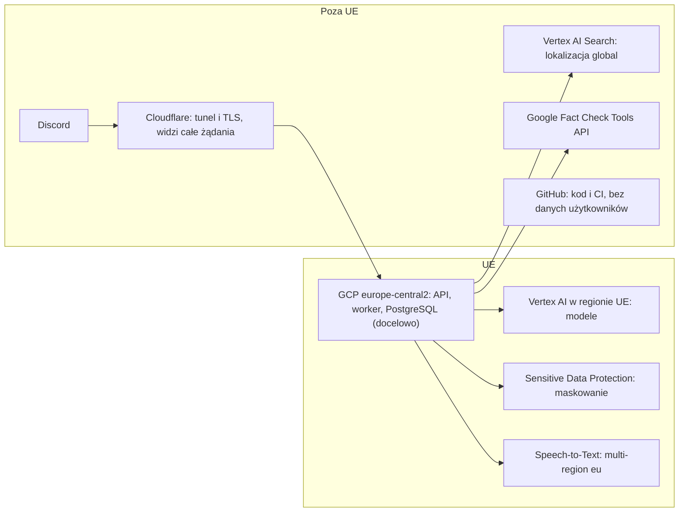

# Prywatność i miejsca przetwarzania

Meritum zbiera jak najmniej danych osobowych i mówi wprost, co przetwarza w UE, a co poza nią ([ADR-13](adr/adr-13.md), [ADR-14](adr/adr-14.md)).

## Co dzieje się z pytaniem

- Konto nie jest potrzebne. Sesja ma losowy identyfikator w przeglądarce, a historia rozmowy zostaje w sessionStorage.
- Oczywiste dane osobowe (telefony, e-maile, numery PESEL) maskuje Google Sensitive Data Protection w UE. Robi to API, zanim wystartuje workflow DBOS, więc ani zapis przebiegu, ani dostawca modelu nie dostają ich w jawnej postaci. Tak samo maskujemy wyniki kroków, które DBOS zapisuje: pobrane strony i odpowiedzi modelu. Maskowanie nie złapie wszystkiego i ograniczenia systemu mówią o tym wprost.
- Zapis przebiegu (`CheckRecord`) zawiera zamaskowane pytanie, czas, kanał, źródła, werdykty, użyte modele, region przetwarzania, koszt i zdarzenia wstrzyknięć.
- Retencja wynosi 30 dni i obejmuje tabele systemowe DBOS. Usuwanie po retencji robi workflow DBOS.
- „Usuń moje sprawdzenia” czyści zapisy sesji, dane workflowów i powiązania ze sprawami. Zalogowany użytkownik może usunąć historię albo konto z historią.

## Kanały poza przeglądarką

Discord daje nazwę i identyfikator użytkownika, a SMS numer telefonu. Przetwarzamy je tylko po to, żeby odpowiedzieć i policzyć powtórzenia. Przechowujemy je jako skrót z solą (`channel_user_hash`), z tą samą retencją 30 dni, i nie pokazujemy moderatorom. W tych kanałach i w MCP ten skrót jest też identyfikatorem sesji. `/usun-moje-dane` na Discordzie i słowo USUN w SMS usuwają zapisy dla danego identyfikatora. Każdy kanał ma osobną politykę prywatności.

Adresy IP służą tylko do limitu zapytań i ochrony przed atakami. Telemetria użycia jest wyłącznie zbiorcza.

## Gdzie przetwarzamy dane

Teraz demo działa na serwerze zespołu (meritum.gburek.app). Docelowo aplikacja z bazą działa w GCP `europe-central2` (Warszawa), a modele w Vertex AI w regionie UE, w którym jest dostępny wybrany model. Migracja pójdzie przez CI/CD.

Najważniejsze pozycje rejestru podmiotów przetwarzających:

| Podmiot | Kraj lub region | Jakie dane |
|---|---|---|
| Serwer zespołu (on-prem) | do uzupełnienia przez zespół | wszystko, co dziś przetwarza demo |
| Cloudflare | USA | całe żądania i odpowiedzi, w tym treść pytań i adresy IP, bo tunel kończy TLS |
| GCP europe-central2 (docelowo) | UE (Warszawa) | API, worker, PostgreSQL z zapisami przebiegu, sprawami i korpusem |
| Vertex AI | region UE z wybranym modelem | zamaskowane pytanie, fragmenty źródeł, odpowiedzi modelu |
| Vertex AI Search | lokalizacja global, poza gwarancją UE | zapytania zbudowane z zamaskowanych twierdzeń |
| Google Fact Check Tools API | region do sprawdzenia | zapytania z twierdzeniami |
| Discord | USA | nazwa i identyfikator użytkownika, treść wiadomości do bota i odpowiedź |
| GitHub | USA | kod, zgłoszenia i logi CI, bez danych użytkowników |

Pełny rejestr, razem z opcjami i kandydatami (Model Armor, Cloudflare Workers AI, Firecrawl, Linkup, bramka SMS, logowanie Google i Microsoft), jest w [ADR-14](adr/adr-14.md). Ten sam rejestr trafia do README i do polityk prywatności kanałów.
