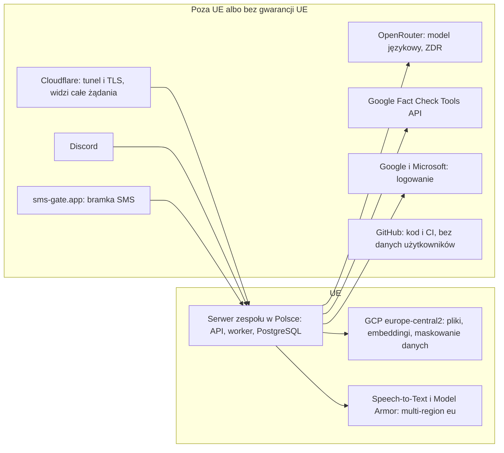

# Prywatność i miejsca przetwarzania

Meritum zbiera jak najmniej danych osobowych i mówi wprost, co przetwarza w UE, a co poza nią ([ADR-13](adr/adr-13.md), [ADR-14](adr/adr-14.md)). Administratorem danych jest Zespół Meritum, który prowadzi instancję demonstracyjną na HackNation 2026. Projekt nie ma partnerstwa z MSZ. Jeśli Meritum zostanie wdrożone pilotażowo albo produkcyjnie, administratorem będzie podmiot wdrażający. Pełne polityki prywatności każdego kanału i rejestr podmiotów są w `copy/privacy.json` w meritum-design-system.

## Co dzieje się z pytaniem

- Konto nie jest potrzebne. Sesja ma losowy identyfikator w przeglądarce, a historia rozmowy zostaje w sessionStorage.
- Oczywiste identyfikatory osoby (telefon, e-mail, PESEL, dowód osobisty, paszport, numer konta, karta płatnicza) maskuje Google Sensitive Data Protection w UE, a uzupełniają je wzorce w kodzie. Robi to API, zanim wystartuje workflow DBOS, więc ani zapis przebiegu, ani dostawca modelu nie dostają ich w jawnej postaci. Tak samo maskujemy wyniki kroków, które DBOS zapisuje: pobrane strony i odpowiedzi modelu. Imion i nazwisk osób publicznych, nazw instytucji, dat ani kwot nie ukrywamy, bo bez nich nie da się sprawdzić twierdzenia. Maskowanie nie złapie wszystkiego, o czym mówią ograniczenia systemu.
- Zapis przebiegu (`CheckRecord`) zawiera zamaskowane pytanie, czas, kanał, źródła, werdykty, użyte modele, region przetwarzania, koszt i zdarzenia wstrzyknięć.
- Nagranie i zrzut ekranu leżą w magazynie plików najdłużej tak, jak zapis sprawdzenia. Tekst odczytany z nagrania albo obrazu żyje tylko w wyniku i zapisie.
- Retencja wynosi 30 dni i obejmuje zapisy sprawdzeń, powiadomienia i tabele systemowe DBOS. Usuwanie po retencji robi workflow DBOS co godzinę.
- „Usuń moje sprawdzenia” czyści zapisy sesji, dane workflowów, pliki i powiązania ze sprawami. Zalogowany użytkownik może usunąć historię albo konto z historią, z osobnym potwierdzeniem.
- Każde wywołanie modelu przechodzi przez detektor wstrzyknięć poleceń. Treść od użytkownika i ze źródeł trafia do modelu wyłącznie jako dane.
- Wynik ma znacznik, że uzasadnienie napisał system AI, a odpowiedzi API niosą nagłówek `AI-Disclosure`.

## Logowanie

Logowanie kontem Google albo Microsoft jest dobrowolne. Prosimy o zakresy `openid`, `email` i `profile`: imię i nazwisko, adres e-mail i identyfikator konta. Nie dostajemy hasła ani dostępu do poczty, plików czy kontaktów. Sesja to podpisane ciasteczko (`HttpOnly`, `Secure`, `SameSite=Lax`) ważne 8 godzin. Dane konta trzymamy, dopóki użytkownik go nie usunie. Te same konta służą personelowi (moderatorom, analitykom, administratorom).

## Kanały poza przeglądarką

Discord daje nazwę i identyfikator użytkownika, SMS numer telefonu, a MCP identyfikator klienta. Przetwarzamy je tylko po to, żeby odpowiedzieć i policzyć powtórzenia. Przechowujemy je wyłącznie jako skrót z solą (`channel_user_hash`), z retencją 30 dni, i nigdy nie pokazujemy moderatorom. Ten skrót jest też identyfikatorem sesji. Ten sam identyfikator w dwóch kanałach daje dwa różne skróty. `/usun-moje-dane` na Discordzie i słowo `USUN` w SMS usuwają zapisy dla danego identyfikatora. Każdy kanał ma osobną politykę prywatności. Wtyczka wysyła tekst posta dopiero po kliknięciu „Sprawdź”, nie skanuje feedu i nie pobiera identyfikatora użytkownika z serwisów społecznościowych.

Zewnętrzne aplikacje czatu, które łączą się z naszym serwerem MCP (ChatGPT, claude.ai i inne), nie są naszymi podmiotami przetwarzającymi. Użytkownik korzysta z nich na własnym koncie, a ich przetwarzanie zależy od regulaminu ich dostawcy.

Adresy IP i region służą do limitu zapytań i ochrony przed atakami. Licznik limitu istnieje tylko przez czas okna limitu, a logi techniczne i bezpieczeństwa z adresem IP usuwamy po 14 dniach. Cloudflare przechowuje własne logi według własnej polityki. Telemetria użycia jest wyłącznie zbiorcza.

## Gdzie przetwarzamy dane

Aplikacja, worker i PostgreSQL działają dziś na serwerze zespołu w Polsce (meritum.gburek.app). Google Cloud w `europe-central2` (Warszawa) przetwarza pliki w prywatnym buckecie oraz wywołania modeli wektorów i maskowania danych; aplikacja i baza tam nie działają. Docelowe środowisko w GCP jest przygotowane w meritum-infra, ale nie jest wdrożone. Model językowy działa przez OpenRouter, poza UE.

Najważniejsze pozycje rejestru podmiotów przetwarzających:

| Podmiot | Kraj lub region | Jakie dane |
|---|---|---|
| Serwer zespołu | Polska | API, worker, PostgreSQL z zapisami przebiegu, sprawami i korpusem; telefon zespołu z kartą prepaid jako bramka SMS |
| Cloudflare | USA | całe żądania i odpowiedzi, w tym treść pytań i adresy IP, bo tunel kończy TLS |
| GCP europe-central2 | UE (Warszawa) | pliki audio i obrazy, wywołania embeddingów i maskowania danych |
| OpenRouter, z modelem Claude Haiku 5.5 w Amazon Bedrock | USA, poza EOG; model bez gwarancji EOG | zamaskowane twierdzenia, fragmenty źródeł i odpowiedzi modelu, z ustawieniem ZDR (bez rutynowego przechowywania), na podstawie standardowych klauzul umownych |
| Google Speech-to-Text v2 (Chirp 3), Cloud Vision, Model Armor | UE (multi-region `eu`, endpoint UE) | nagrania i transkrypcje, obrazy, tekst wejścia i stron do sprawdzenia pod kątem poleceń |
| Wyszukiwanie na żywo (własny SearXNG, opcjonalnie Linkup) | nasz serwer; zapytania SearXNG idą do wyszukiwarek, także spoza UE; Linkup w UE, a bez umowy Enterprise możliwe także USA, Kanada i APAC | zapytania zbudowane z zamaskowanych twierdzeń |
| Crawl4AI (nasz) i opcjonalnie Firecrawl | nasz serwer; Firecrawl USA | adresy i treść pobieranych stron |
| Google Fact Check Tools API | poza gwarancją EOG | zapytania z twierdzeniami |
| Discord | USA | nazwa i identyfikator użytkownika, treść wiadomości do bota i odpowiedź |
| sms-gate.app (tryb Cloud) | region nieujawniony, poza gwarancją EOG | numer telefonu, treść SMS-a i odpowiedź |
| Google i Microsoft (logowanie) | USA | imię i nazwisko, e-mail i identyfikator konta, tylko po zalogowaniu |
| Powiadomienia moderatora (Cloudflare Email Workers, webhook, Google Chat) | poza gwarancją EOG | e-mail moderatora, numer i streszczenie sprawy |
| Serwer MCP EUvsDisinfo (Vercel) | USA | token i nasze zapytania o strony bazy, bez danych użytkowników |
| GitHub | USA | kod, zgłoszenia i logi CI, bez danych użytkowników |

Planowane i opcjonalne: reranker fragmentów (Cloudflare Workers AI albo Vertex AI ranking API, domyślnie wyłączony, więc żadne fragmenty źródeł nie wychodzą do jego dostawcy), model Mistral w Vertex AI w UE i ocena zrozumiałości przez Jasnopis. Pełny rejestr z kolumnami „po co” jest w [ADR-14](adr/adr-14.md) i w `copy/privacy.json`, a ten sam rejestr trafia do README i do polityk kanałów.
