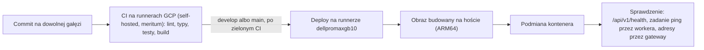

# Wdrożenie i uruchomienie lokalne

## Uruchomienie jednym poleceniem

Repozytorium zbiorcze łączy pozostałe jako submoduły i ma `docker-compose.yml`, który buduje te same obrazy co dev i prd: Postgres z pgvector i polskim słownikiem, worker DBOS, API, frontend i makiety.

```bash
git clone --recurse-submodules git@github.com:Meritum-HackNation2026/meritum-monorepo.git
cd meritum-monorepo
ssh-add ~/.ssh/id_ed25519    # klucz z dostępem do organizacji, dopóki meritum-core jest prywatne
docker compose up --build
```

| Adres | Co |
|---|---|
| http://localhost:8080 | aplikacja webowa; nginx przekazuje `/api` do API |
| http://localhost:8080/api/docs | dokumentacja API |
| http://localhost:3000 | makiety platform (`/x/`, `/facebook/`, `/instagram/`, `/reddit/`, `/tiktok/`) |

Każde repozytorium z kodem opisuje w swoim README pracę nad nim bez całego stosu: `uv sync` i `uv run pytest` w repozytoriach Pythona, `pnpm install` i `pnpm dev` w repozytoriach TypeScriptu.

## Środowiska

| Środowisko | Gałąź | Schemat aplikacji w bazie `meritum` | Baza DBOS |
|---|---|---|---|
| dev | `develop` w meritum-frontend, meritum-backend i meritum-worker | `app_dev` | `meritum_dbos_dev` |
| prd po migracji | `main` | `app_prd` | `meritum_dbos_prd` |

Tabela pokazuje układ z README meritum-infra. Worker na `develop` już go używa, a README backendu i workera na `main` nadal podają osobne schematy `api_prd` i `worker_prd`.

Po przejściu na nowy układ API i worker współdzielą schemat aplikacji w obrębie swojego środowiska. Worker jest jego właścicielem, a API ma prawo czytać i zapisywać dane. Oba środowiska czytają wspólny schemat `corpus`. Zapisuje w nim tylko worker prd. Makiety są wdrażane z `main` i mają własny schemat `mocks_prd`. Role i uprawnienia opisuje [README infrastruktury](https://github.com/Meritum-HackNation2026/meritum-infra/blob/main/README.md).

Kontener `meritum-mocks-dev` i schemat `mocks_dev` zostały po dawnym przepływie i nie dostają nowych wersji.

Wszystkie środowiska dzielą kontener PostgreSQL `meritum-postgres`. Droga żądania: Cloudflare, tunel na serwer `dellpromaxgb10`, `meritum-gateway` (nginx platformy), kontener aplikacji. Platformę stawia idempotentny skrypt z meritum-infra.

## CI/CD



- CI działa na każdej gałęzi, na trzech maszynach GCP w `europe-central2-a`, zarejestrowanych jako runnery organizacji z etykietami `self-hosted, meritum` ([ADR-15](adr/adr-15.md)).
- CD rusza po zielonym CI: z `develop` na dev (frontend, backend, worker) i z `main` na prd (te trzy oraz makiety).
- Wtyczka nie ma serwera: na `main` CI buduje zip z adresem API prd i zostawia go jako artefakt przebiegu.
- Testy end-to-end i testy wymagające kilku komponentów naraz nie trafiają do CI. Uruchamia się je ręcznie albo skryptem lokalnie.

Organizacja jest na planie Free, więc sekrety organizacji nie trafiają do repozytoriów prywatnych. Każde repozytorium ma własne sekrety, na przykład `MERITUM_CORE_SSH_KEY` w backendzie i workerze.

## Migracje

Wdrożenie workera uruchamia migracje z obrazu nowej wersji przed podmianą kontenera.

1. `dbos migrate` aktualizuje bazę DBOS danego środowiska i nadaje roli API uprawnienia potrzebne do zlecania zadań.
2. `meritum-worker-migrate` stosuje migracje SQL z meritum-core w `app_dev` lub `app_prd`.
3. Wdrożenie z `main` uruchamia też migracje `corpus`. Muszą być zgodne wstecz, ponieważ dev może nadal działać na starszej wersji kodu.

Błąd migracji zatrzymuje wdrożenie przed podmianą kontenera. Migracje aplikacji i korpusu mają osobne transakcje, więc po błędzie migracji `corpus` zmiany w `app_prd` są już zatwierdzone. Kolejność i obsługę błędów opisuje [README workera](https://github.com/Meritum-HackNation2026/meritum-worker/blob/develop/README.md#migracje).

Przy przejściu na nowy układ bazy w każdym środowisku najpierw wdrażamy workera. Dopiero po jego migracjach API może zlecać zadania w nowej bazie DBOS.

## Ta dokumentacja

Strona powstaje z repozytorium [meritum-docs](https://github.com/Meritum-HackNation2026/meritum-docs) w Zensical i trafia z gałęzi `main` na Cloudflare Pages: [meritum-docs.pages.dev](https://meritum-docs.pages.dev). Codzienny workflow odświeża strony generowane z dokumentu produktowego, kontraktów i listy repozytoriów i otwiera PR do `main`, gdy coś się zmieniło. Szczegóły są w README repozytorium.
