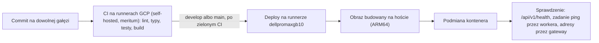

# Wdrożenie i uruchomienie lokalne

## Uruchomienie jednym poleceniem

Repozytorium zbiorcze łączy pozostałe jako submoduły i ma `docker-compose.yml`, który buduje te same obrazy co dev i prd: Postgres z pgvector i polskim słownikiem, worker DBOS, API, frontend i makiety.

```bash
git clone --recurse-submodules git@github.com:Meritum-HackNation2026/meritum-monorepo.git
cd meritum-monorepo
ssh-add ~/.ssh/id_ed25519    # klucz z dostępem do organizacji, dopóki meritum-core jest prywatne
docker compose up --build
```

| Adres | Co |
|---|---|
| http://localhost:8080 | aplikacja webowa; nginx przekazuje `/api` do API |
| http://localhost:8080/api/docs | dokumentacja API |
| http://localhost:3000 | makiety platform (`/x/`, `/facebook/`, `/instagram/`, `/reddit/`, `/tiktok/`) |

Lokalnie jedna rola bazy robi wszystko. Na serwerze każda aplikacja i każde środowisko ma własną rolę i schemat.

Każde repozytorium z kodem opisuje w swoim README pracę nad nim bez całego stosu: `uv sync` i `uv run pytest` w repozytoriach Pythona, `pnpm install` i `pnpm dev` w repozytoriach TypeScriptu.

## Środowiska

| Środowisko | Gałąź | Kontenery | Schematy w bazie `meritum` |
|---|---|---|---|
| dev | `develop` w meritum-frontend, meritum-backend i meritum-worker | `meritum-web-dev`, `meritum-api-dev`, `meritum-worker-dev` | `api_dev`, `worker_dev` |
| prd | `main` | `meritum-web-prd`, `meritum-api-prd`, `meritum-worker-prd`, `meritum-mocks-prd` | `api_prd`, `worker_prd`, `mocks_prd` |

Pozostałe repozytoria mają tylko gałąź `main`, więc makiety wdrażają się tylko na prd. Kontener `meritum-mocks-dev` i schemat `mocks_dev` zostały po dawnym przepływie i nie dostają nowych wersji.

Wszystkie środowiska dzielą kontener PostgreSQL `meritum-postgres`. Droga żądania: Cloudflare, tunel na serwer `dellpromaxgb10`, `meritum-gateway` (nginx platformy), kontener aplikacji. Platformę stawia idempotentny skrypt z meritum-infra.

## CI/CD



- CI działa na każdej gałęzi, na trzech maszynach GCP w `europe-central2-a`, zarejestrowanych jako runnery organizacji z etykietami `self-hosted, meritum` ([ADR-15](adr/adr-15.md)).
- CD rusza po zielonym CI: z `develop` na dev (frontend, backend, worker) i z `main` na prd (te trzy oraz makiety).
- Wtyczka nie ma serwera: na `main` CI buduje zip z adresem API prd i zostawia go jako artefakt przebiegu.
- Testy end-to-end i testy wymagające kilku komponentów naraz nie trafiają do CI. Uruchamia się je ręcznie albo skryptem lokalnie.

Organizacja jest na planie Free, więc sekrety organizacji nie trafiają do repozytoriów prywatnych. Każde repozytorium ma własne sekrety, na przykład `MERITUM_CORE_SSH_KEY` w backendzie i workerze.

## Ta dokumentacja

Strona powstaje z repozytorium [meritum-docs](https://github.com/Meritum-HackNation2026/meritum-docs) w Zensical i trafia z gałęzi `main` na Cloudflare Pages: [meritum-docs.pages.dev](https://meritum-docs.pages.dev). Codzienny workflow odświeża strony generowane z dokumentu produktowego, kontraktów i listy repozytoriów i otwiera PR do `main`, gdy coś się zmieniło. Szczegóły są w README repozytorium.
