# Współtworzenie

Te same zasady obowiązują ludzi i agentów AI. Pełna wersja dla agentów jest w [AGENTS.md repozytorium zbiorczego](https://github.com/Meritum-HackNation2026/meritum-monorepo/blob/main/AGENTS.md), a skille, które ją rozwijają, w `.claude/skills/`.

## Przepływ pracy

```mermaid
flowchart LR
  plan["Plan: historie i funkcje z dokumentu produktowego stają się zgłoszeniami"] --> accept["Akceptacja: człowiek zmienia status na ready"]
  accept --> claim["Przejęcie zgłoszenia etykietą i komentarzem"]
  claim --> build["Budowa test-first we własnym worktree"]
  build --> pr["PR do gałęzi integracyjnej z Closes #n"]
  pr --> review["Przegląd: najwyżej 3 rundy, dwóch niezależnych recenzentów"]
  review --> merge["Merge do gałęzi integracyjnej"]
  merge --> release["Backend, worker, frontend: człowiek wydaje develop do main"]
```

1. Nowe zgłoszenie zaczyna w `status: triage`. Agent nigdy nie zaczyna pracy nad takim zgłoszeniem.
2. Agent przejmuje gotowe, nieprzypisane zgłoszenie z zamkniętymi zależnościami, zostawia komentarz `Claimed by <agent>, branch <branch>` i sprawdza, czy nikt go nie wyprzedził (skill `meritum-issue-claiming`).
3. Gałąź `<typ>/<numer>-<opis>` odchodzi od gałęzi integracyjnej repozytorium: `develop` w meritum-backend, meritum-worker i meritum-frontend, `main` we wszystkich pozostałych. Budowa idzie test-first: scenariusz behave ze zgłoszenia najpierw nie przechodzi, potem jeden test i jedna minimalna zmiana na cykl.
4. Autor nigdy nie zatwierdza własnego PR. Każda runda przeglądu to dwóch świeżych recenzentów, jeden od zasad architektury i UI, drugi od zgłoszenia (skill `meritum-pr-review-loop`).
5. W meritum-backend, meritum-worker i meritum-frontend PR `develop` → `main` robi człowiek. Pozostałe repozytoria nie mają `develop`, więc merge do `main` jest od razu wydaniem. Bezpośrednie pushe do `develop` i `main` są zabronione; plan Free nie chroni gałęzi w repozytoriach prywatnych, więc pilnuje tego zespół.

## Twarde zasady

- Kontrakty zmieniają się tylko w meritum-core ([ADR-02](adr/adr-02.md)); kopie w design systemie są synchronizowane, nie edytowane.
- Interfejs korzysta wyłącznie z design systemu: tokenów, krojów Archivo i Azeret Mono, komponentów i tekstów z `copy/pl.json` (skill `meritum-ui`). Jedyny wyjątek to skórki platform widżetu i makiet.
- Kod przestrzega zasad z [Porty i adaptery](architektura/porty-i-adaptery.md) (skill `meritum-architecture`).
- Żadnych sekretów, tokenów, prawdziwych danych osobowych ani ukrytego zestawu jury w kodzie, zgłoszeniach i logach.
- Gitleaks skanuje historię pushowanej gałęzi; lokalnie włącz hook `scripts/setup-git-hooks.sh`.
- Żadnych testów end-to-end ani testów wymagających kilku komponentów naraz w CI.
- Żadnych tagów, wydań ani PR `develop` → `main` bez prośby człowieka.
- Commity, PR, zgłoszenia i komentarze nie mają podpisów wskazujących AI: bez `Co-Authored-By` dla AI, bez „Generated with”, bez emoji robota.

## Język

Kod, identyfikatory, docstringi, skille i zakresy commitów piszemy po angielsku. Zgłoszenia, opisy PR, teksty dla użytkowników, README i ta dokumentacja są po polsku.

## Zmiany w tej dokumentacji

Artykuły piszemy ręcznie w `docs/`. Każdy tekst przechodzi przez skill `humanizer` z `.claude/skills/humanizer/`, zanim trafi do PR. Fakty pochodzą z dokumentu produktowego i z repozytoriów; niczego nie dopisujemy z głowy. Wygląd strony wynika z design systemu Meritum i ma pierwszeństwo przed innymi wyborami stylu.

Strony z komentarzem „Wygenerowane przez scripts/generate.py” (decyzje ADR, słownik, kontrakty, mapa repozytoriów) nadpisuje codzienne odświeżanie. Zmiany w nich wprowadza się u źródła: w dokumencie produktowym, w meritum-core albo w opisie repozytorium na GitHubie. Zasady dla agentów są w [AGENTS.md meritum-docs](https://github.com/Meritum-HackNation2026/meritum-docs/blob/main/AGENTS.md).
